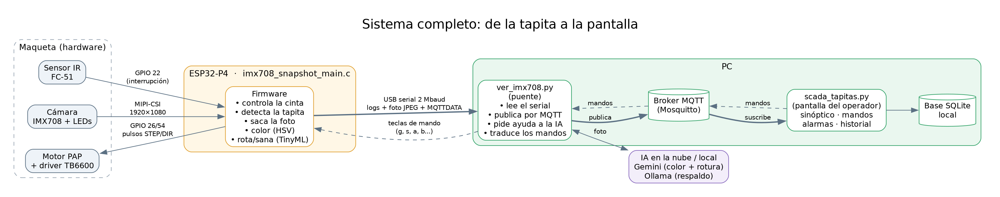
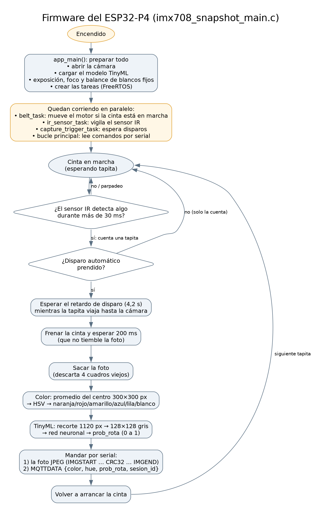
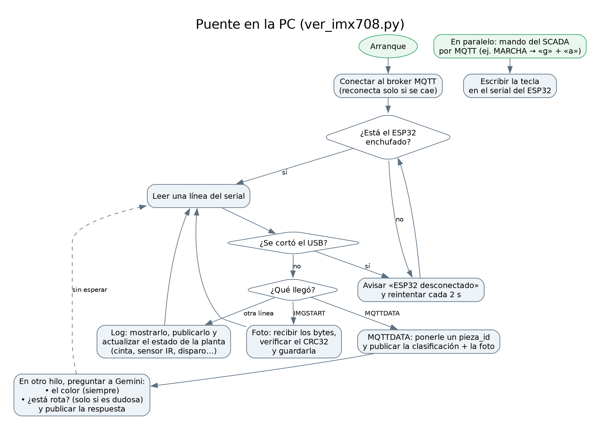

# Cómo funciona el sistema

Guía para explicar el proyecto. Los diagramas están en
[`diagramas/`](diagramas/) (PNG para las diapositivas, `.dot` para editarlos
y regenerarlos con `dot -Tpng -Gdpi=150 archivo.dot -o archivo.png`).

## La idea en una frase

Una cinta lleva cada tapita hasta una cámara; el **ESP32-P4** le saca una
foto, decide el **color** y si está **sana o rota** (con una red neuronal que
corre en el propio microcontrolador), y manda el resultado a la **PC**, que lo
muestra en un **SCADA** desde donde también se maneja la maqueta.



## Las tres partes

| Parte | Dónde corre | Qué hace |
|---|---|---|
| `imx708_snapshot_main.c` | ESP32-P4 | Todo lo de tiempo real: cinta, sensor, foto, color y TinyML. **Clasifica solo, sin la PC.** |
| `ver_imx708.py` | PC | Puente: pasa lo que dice el ESP32 por serial a MQTT, pide segunda opinión a la IA y traduce los mandos del SCADA a teclas. |
| `scada_tapitas.py` | PC | Pantalla del operador: muestra la planta y manda órdenes. No clasifica nada. |

La decisión sana/rota y el color base salen del ESP32. La PC suma la
comunicación, la interfaz y la IA de respaldo.

## 1. Firmware del ESP32-P4 (`imx708_snapshot_main.c`)



**Al encender** (`app_main`) prepara la cámara y deja fijos la exposición, el
foco y el balance de blancos, para que todas las fotos salgan iguales y el
color se pueda comparar. Carga el modelo TinyML una sola vez.

**Después quedan varias tareas de FreeRTOS corriendo en paralelo:**

- `belt_task`: mientras la cinta está en marcha, da pulsos al driver TB6600
  del motor paso a paso.
- `ir_sensor_task`: el sensor IR dispara una interrupción. Para no contar
  ruido ni contar dos veces la misma tapita, exige que la detección dure 30 ms
  y que la salida dure 1 s (las tapitas con agujeros "parpadean" al pasar).
- `capture_trigger_task`: cuando el sensor detecta, espera el **retardo de
  disparo** (4,2 s, lo que tarda la tapita en llegar a la cámara), frena la
  cinta, deja asentar 200 ms, saca la foto y vuelve a arrancar.
- El bucle principal lee comandos por el serial (una letra cada uno: `g`
  arranca la cinta, `s` la para, `a` el disparo automático, `b` baja el azul…).

**Por cada foto:**

1. **Color**: promedia un cuadrado de 300×300 px en el centro (descartando
   los píxeles oscuros, que son sombra o fondo), lo pasa a **HSV** y decide
   por el matiz (H): rojo, naranja, amarillo, azul, lila o blanco.
2. **Sana/rota (TinyML)**: recorta el centro, lo achica a 128×128 en grises
   y lo pasa por una red neuronal convolucional cuantizada a int8 (TensorFlow
   Lite Micro). Devuelve `prob_rota`, de 0 a 1.
3. **Envío**: manda por USB la foto en JPEG, con un CRC32 para detectar si
   llegó corrupta, y después una línea `MQTTDATA {json}` con el resultado.

### Trama serial (ejemplo)

```
IMGSTART name=imx708 fmt=jpeg w=1920 h=1080 len=183422 crc32=9f3a01c2
<183422 bytes del JPEG>
IMGEND
MQTTDATA {"color":"azul","hue":214.30,"saturation":0.612,"value":0.540,"prob_rota":0.0712,"sesion_id":"ses-1a2b3c4d"}
```

¿Por qué no manda por WiFi? El WiFi de esta placa (un ESP32-C6 conectado por
SDIO) se cuelga cuando el motor está andando: es un bug abierto de Espressif
(`esp-hosted-mcu#167`). Por eso todo viaja por el cable USB.

## 2. Puente en la PC (`ver_imx708.py`)



- Lee el serial línea por línea:
  - `IMGSTART`: recibe la foto, verifica el CRC32 y la guarda.
  - `MQTTDATA`: le pone un `pieza_id` único y publica la clasificación y la
    foto en el broker MQTT.
  - Cualquier otra línea es log: la muestra, la publica y la usa para saber el
    estado de la planta (cinta en marcha, sensor que detectó, disparo
    automático…).
- **IA**: en otro hilo, para no frenar la lectura, le pregunta a Gemini el
  color de cada tapita (corrige al ESP32 cuando cambia la luz) y, si la
  tapita es **dudosa**, si está rota. Si no hay internet usa Ollama local para
  la rotura y queda el color del ESP32.
- **Mandos**: recibe las órdenes del SCADA por MQTT y las escribe como teclas
  en el serial (MARCHA = `g` + `a`).
- **Desconexiones**: si se desenchufa el USB avisa y reintenta cada 2 s; si se
  cae el broker, reconecta solo. Si el puente se cierra, el broker avisa al
  SCADA con un mensaje de "última voluntad" (*last will*).

### Criterio sana / rota / dudosa

Con `prob_rota` del modelo:

- `prob_rota > 0,20` → **rota** (umbral bajo a propósito: es peor dejar pasar
  una rota que descartar una sana).
- Si la confianza da menos de 50 % → **dudosa**, y la revisa la IA.
- Si no → **sana**.

## 3. SCADA (`scada_tapitas.py`)

No toma decisiones de clasificación: es la pantalla del operador. Se suscribe
a los tópicos MQTT y:

- dibuja la maqueta en vivo (tapitas viajando, sensor, cámara, motor) y la
  cadena de comunicación con cada enlace en verde o rojo;
- manda MARCHA/PARADA, mandos manuales y ajustes (balance de color,
  exposición, retardo);
- registra eventos y alarmas (desconexiones, piezas rotas) y guarda el
  historial en una base SQLite local.

### Tópicos MQTT

| Tópico | Quién publica | Contenido |
|---|---|---|
| `tapitas/clasificacion` | puente | JSON del ESP32 + `pieza_id` |
| `tapitas/imagen/<sesion>` | puente | JPEG de la tapita |
| `tapitas/color_ia/<sesion>` | puente | color según Gemini |
| `tapitas/veredicto_ia/<sesion>` | puente | segunda opinión de rotura (dudosas) |
| `tapitas/planta/estado` | puente | estado de la planta (retenido) |
| `tapitas/planta/evento` | puente | sensor IR, captura, reinicio |
| `tapitas/planta/log` | puente | logs del ESP32 |
| `tapitas/puente/estado` | puente / broker | `online` / `offline` (*last will*) |
| `tapitas/planta/comando` | SCADA | órdenes (`marcha`, `parada`, `foto`…) |

## Recorrido de una tapita (para contarlo en voz alta)

1. El operador aprieta **MARCHA** en el SCADA → MQTT → puente → teclas `g` y
   `a` por USB → el ESP32 arranca la cinta y el disparo automático.
2. La tapita entra al túnel y corta el **sensor IR** → interrupción en el
   ESP32 → el SCADA la dibuja entrando.
3. A los 4,2 s está bajo la cámara: el ESP32 **frena la cinta** y saca la
   **foto**.
4. El ESP32 calcula el **color (HSV)** y **prob_rota (TinyML)** y manda la foto
   y el resultado por USB.
5. El puente lo publica en MQTT; el SCADA muestra la pieza con su color y su
   estado, y la guarda en el historial.
6. Segundos después llega la respuesta de **Gemini** (color y, si era dudosa,
   rotura) y el SCADA la actualiza.
7. El ESP32 vuelve a arrancar la cinta y la tapita sale.
